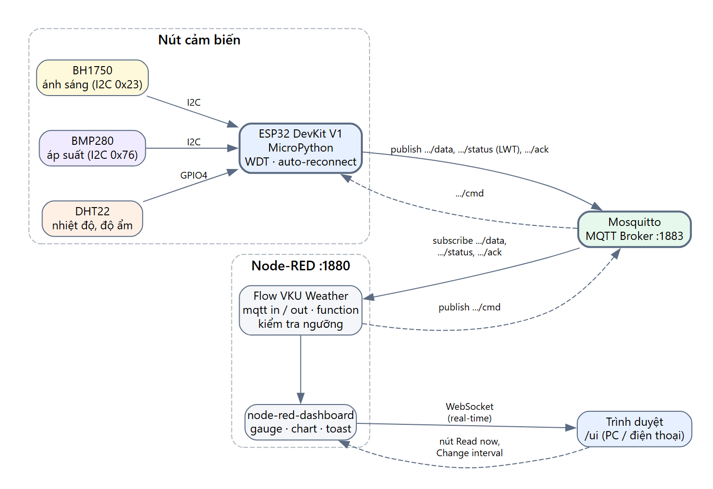

# Hệ thống quan trắc nhiệt độ, độ ẩm, áp suất và ánh sáng — ESP32 + MQTT

ESP32 đọc **DHT22** (nhiệt độ, độ ẩm), **BMP280** (áp suất) và **BH1750** (ánh sáng), gửi JSON qua **MQTT** tới
Mosquitto. **Node-RED** subscribe broker, hiển thị **dashboard** real-time (gauge, biểu đồ, trạng thái Online/Offline,
cảnh báo vượt ngưỡng) và gửi lệnh ngược xuống ESP32 (đổi chu kỳ đo, đo ngay).



Kế hoạch chi tiết: [task.md](task.md).

## Cấu trúc thư mục

```
firmware/          MicroPython cho ESP32
  boot.py          kết nối Wi-Fi + đồng bộ NTP khi khởi động
  main.py          vòng lặp chính: đọc cảm biến, publish, nhận lệnh, LWT, WDT, backoff
  config.py        SSID, mật khẩu, broker, device_id, chân GPIO   ← SỬA FILE NÀY
  wifi.py          kết nối Wi-Fi có timeout
  sensors.py       read_all() gom 3 cảm biến, cảm biến lỗi → null + errors[]
  lib/bmp280.py    driver BMP280 (công thức bù theo datasheet Bosch)
  lib/bh1750.py    driver BH1750
  lib/umqtt/simple.py  client MQTT (chỉ cần nếu firmware chưa có sẵn)
node-red/          dashboard Node-RED (flows.json, settings.js, package.json)
broker/            mosquitto.conf, docker-compose.yml
tools/
  fake_device.py   giả lập ESP32 qua MQTT (chạy thử khi chưa có phần cứng)
tests/
  test_bmp280.py   pytest: công thức bù BMP280 của firmware
requirements.txt   paho-mqtt (bộ giả lập), pytest
docs/              architecture.png, wiring.png (+ file .dot nguồn)
```

## 1. Nối dây

| Cảm biến | Chân | ESP32 |
|---|---|---|
| DHT22 | VCC / DATA / GND | 3V3 / **GPIO4** / GND |
| BMP280 | VCC / GND / SDA / SCL / CSB / SDO | 3V3 / GND / **GPIO21** / **GPIO22** / 3V3 (chế độ I2C) / GND (→ 0x76) |
| BH1750 | VCC / GND / SDA / SCL / ADDR | 3V3 / GND / **GPIO21** / **GPIO22** / GND (→ 0x23) |

BMP280 (0x76) và BH1750 (0x23) dùng chung bus I2C. Module BMP280 chỉ chịu **3.3 V** (không nối 5V/VIN). Sơ đồ: [docs/wiring.drawio.png](docs/wiring.drawio.png).

## 2. Chạy MQTT broker

Mosquitto đã cài trên Windows (dịch vụ chạy sẵn cổng 1883), hoặc chạy bằng file cấu hình của dự án:

```powershell
mosquitto -c broker/mosquitto.conf -v
# hoặc Docker:  docker compose -f broker/docker-compose.yml up -d
```

Kiểm tra: `mosquitto_sub -t "vku/weather/#" -v`.
Nếu ESP32 không kết nối được: mở cổng **1883** trên Windows Firewall, ESP32 và máy tính phải cùng mạng (Wi-Fi 2.4 GHz).

## 3. Chạy dashboard Node-RED

```powershell
npm install -g node-red        # một lần, nếu máy chưa có Node-RED
cd node-red
npm install                    # một lần: cài node-red-dashboard
npm start
```

- Dashboard: <http://localhost:1880/ui> (điện thoại cùng mạng LAN: `http://<IP-máy-tính>:1880/ui`): gauge, biểu đồ 1 giờ,
  trạng thái Online/Offline, cảnh báo ngưỡng, nút **Read now** và **Change interval**.
- Trình soạn flow: <http://localhost:1880> (tab **VKU Weather**).
- Cổng 1880 đang bị Node-RED khác chiếm thì đổi cổng: `$env:PORT=1881; npm start`.
- Sửa `flows.json` bằng tay thì phải khởi động lại Node-RED (Ctrl+C rồi `npm start`) mới nạp lại flow.
- Khi nộp bài không cần chép thư mục `node-red/node_modules` (cài lại bằng `npm install`).

Biểu đồ chỉ giữ dữ liệu 1 giờ gần nhất trong RAM, khởi động lại Node-RED là mất.

### Chưa có phần cứng? Dùng bộ giả lập

```powershell
pip install -r requirements.txt
python tools/fake_device.py                               # esp32-01, gửi mỗi 5 s
python tools/fake_device.py --drop 3 --bad 5 --sensor-fail 3   # mất gói / bản tin lỗi / DHT22 lỗi
python tools/fake_device.py --hot                         # nóng > 35 °C → cảnh báo
```

Bộ giả lập xử lý đủ lệnh `set_interval`, `read_now`, `reboot` và đặt Last Will như ESP32 thật. Dashboard Node-RED chỉ
hiển thị thiết bị `esp32-01` (hằng `DEVICE` trong các node function).

## 4. Nạp firmware cho ESP32

1. Nạp MicroPython (một lần):
   ```powershell
   esptool --chip esp32 --port COM5 erase_flash
   esptool --chip esp32 --port COM5 --baud 460800 write_flash -z 0x1000 ESP32_GENERIC-xxxx.bin
   ```
2. Sửa `firmware/config.py`: `WIFI_SSID`, `WIFI_PASSWORD`, `MQTT_HOST` (IP máy chạy Mosquitto), `DEVICE_ID`.
3. Chép code lên board và chạy:
   ```powershell
   cd firmware
   mpremote connect COM5 fs cp boot.py main.py config.py wifi.py sensors.py :
   mpremote connect COM5 fs mkdir lib
   mpremote connect COM5 fs cp lib/bmp280.py lib/bh1750.py :lib/
   mpremote connect COM5 reset
   mpremote connect COM5 repl        # xem log (Ctrl+] để thoát)
   ```
   (Chỉ chép `lib/umqtt/simple.py` nếu `import umqtt.simple` báo lỗi trên board.)

Kiểm tra bus I2C trong REPL: `from sensors import Sensors; Sensors().scan()` → phải thấy `['0x23', '0x76']`.

LED GPIO2: nháy = đang kết nối, sáng = đã kết nối, tắt chớp nhanh = đang gửi dữ liệu.

## 5. Giao thức MQTT

| Topic | Chiều | QoS | Retain | Nội dung |
|---|---|---|---|---|
| `vku/weather/<id>/data` | ESP32 → Node-RED | 1 | – | JSON số đo (xem task.md §4.2) + `interval` |
| `vku/weather/<id>/status` | ESP32 → Node-RED | 1 | ✔ | `online`; `offline` qua Last Will |
| `vku/weather/<id>/cmd` | Node-RED → ESP32 | 1 | – | `{"cmd":"set_interval","value":10}` · `{"cmd":"read_now"}` · `{"cmd":"reboot"}` |
| `vku/weather/<id>/ack` | ESP32 → Node-RED | 1 | – | `{"cmd":..., "ok":true, "value":...}` |

Dashboard có nút cho `read_now` và `set_interval`. Gửi lệnh thủ công (vd. `reboot`):
`mosquitto_pub -t vku/weather/esp32-01/cmd -m "{\"cmd\":\"reboot\"}"`.

## 6. Cấu hình ngưỡng cảnh báo

Ngưỡng nằm trong node function **Check thresholds** của flow (mở trình soạn flow, nháy đúp vào node):
`LIMITS` mặc định nhiệt độ > 35 °C, độ ẩm < 30 % hoặc > 90 %, ánh sáng < 50 lux (`null` = tắt phía đó).
Cùng một đại lượng chỉ cảnh báo lại sau `COOLDOWN_MS` = 300 000 ms (5 phút).

## 7. Kiểm thử

```powershell
pip install -r requirements.txt
python -m pytest -q tests
```

Kiểm tra công thức bù BMP280 của firmware so với ví dụ trong datasheet (25,08 °C; 100 653 Pa).

## Xử lý sự cố

| Hiện tượng | Cách xử lý |
|---|---|
| `i2c.scan()` rỗng | Kiểm tra SDA/SCL, nguồn 3V3, giảm `I2C_FREQ` xuống 50000, chân ADDR của BH1750 |
| DHT22 luôn lỗi | Chu kỳ ≥ 2 s, điện trở kéo lên 10 kΩ (cảm biến trần), dây ngắn |
| Nhiệt độ cao hơn thực tế | Đặt cảm biến xa ESP32 (nhiệt toả ra từ chip) |
| ESP32 không vào Wi-Fi trường | Chỉ hỗ trợ 2.4 GHz, không hỗ trợ trang đăng nhập → dùng hotspot điện thoại |
| Mất gói khi gửi dồn dập | Tăng `max_queued_messages` trong mosquitto.conf (đã đặt 10000) |
